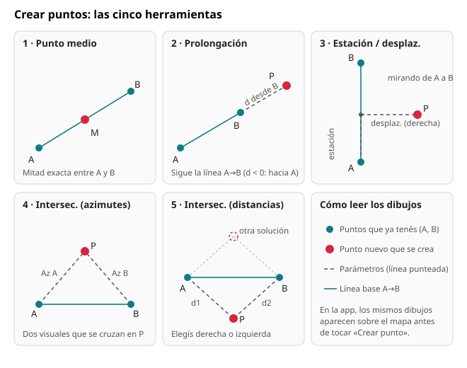
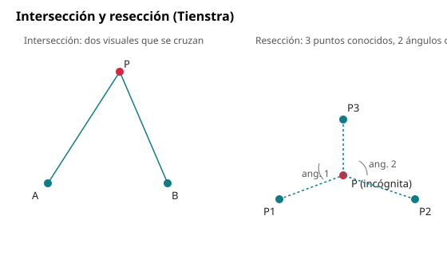
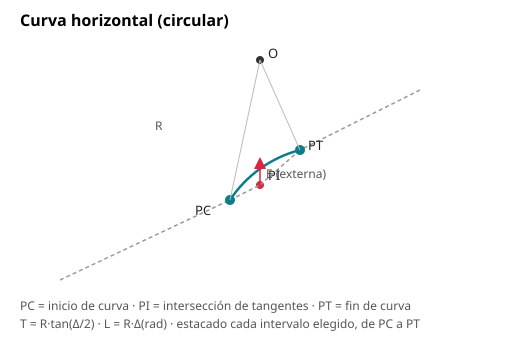

# Ayuda — GNSS

Guía de uso de todas las funciones de la app, con diagramas explicativos en vez de capturas de
pantalla reales (la numeración y el aspecto exacto de cada pantalla puede cambiar; los diagramas
describen el concepto, no un layout fijo).

## Índice

- [GNSS: conexión al receptor](#gnss-conexión-al-receptor)
- [Relevar](#relevar)
- [Puntos](#puntos)
  - [Fotografías georreferenciadas](#fotografías-georreferenciadas)
  - [Exportar / importar](#exportar--importar)
  - [Reporte de replanteo en PDF](#reporte-de-replanteo-en-pdf)
- [Cálculo (COGO)](#cálculo-cogo)
  - [Medición](#medición)
  - [Crear puntos](#crear-puntos)
  - [Poligonal](#poligonal)
  - [Intersección y resección](#intersección-y-resección)
  - [Curvas horizontales](#curvas-horizontales)
  - [Superficie con descuento](#superficie-con-descuento)
- [Replanteo](#replanteo)
  - [Modo Punto](#modo-punto)
  - [Modo Eje](#modo-eje)
- [Plomada virtual](#plomada-virtual)
- [Proyectos](#proyectos)
  - [Sistemas de coordenadas](#sistemas-de-coordenadas)
  - [Nomenclatura catastral](#nomenclatura-catastral)
- [Mapa y tema](#mapa-y-tema)

---

## GNSS: conexión al receptor

Pantalla **GNSS** (pestaña inferior). Conectá el Emlid Reach RS2 por Bluetooth SPP, TCP (cliente o
servidor) o UDP. La app reintenta la conexión sola si se corta y mantiene un servicio en primer
plano para no perderla con la pantalla apagada. La consola NMEA de abajo sirve para confirmar que
llegan tramas GGA/GST/GSA/RMC — sin GST no hay HRMS/VRMS.

La barra de estado (visible en todas las pantallas) resume: solución por color (verde FIX,
amarillo FLOAT, naranja DGPS, rojo SINGLE/sin datos), satélites, HRMS, VRMS, PDOP y edad de la
corrección.

## Relevar

Promedia 1/5/10/30 épocas con filtros opcionales (exigir FIX, HRMS/VRMS máximos). El nombre del
punto se autoincrementa con el prefijo configurado (P001, P002…); podés agregar código/descripción
y la altura de antena. La desviación guardada combina el GST del receptor con la dispersión real
de las épocas promediadas.

### GCP para fotogrametría

Al medir un punto (botón **+**) el selector **Tipo** permite elegir **Punto** o **GCP**. Un GCP
(punto de control terrestre) se mide igual que cualquier punto —promediando épocas con los filtros
de calidad—, pero queda marcado con su propio tipo (color rosa en el mapa y en la lista), con el
nombre autoincrementado **GCP001, GCP002…**. Para los GCP conviene exigir solución **FIX** y usar
más épocas (o segundos) en los ajustes de medición. La altura del pole se descuenta como siempre.

## Puntos

Lista de todos los puntos del proyecto activo, filtrable por tipo (relevado, COGO, a replantear,
replanteado). Tocar un punto abre su ficha para editar nombre/código, ver todos sus datos y
eliminarlo.

### Fotografías georreferenciadas

Desde la ficha de un punto, el botón de cámara saca una foto con la app de cámara del teléfono
(sin pedir el permiso de cámara en la app: se delega a la app externa) y la asocia a ese punto.
Se puede reemplazar o quitar la foto en cualquier momento.

### Exportar / importar

- **CSV**: exporta todos los puntos visibles (según el filtro activo) con sus coordenadas,
  solución y metadatos, listo para abrir en una planilla.
- **Exportar GCP (fotogrametría)**: menú **⋮ → Exportar GCP**. Exporta **solo** los puntos de tipo
  GCP del proyecto (no depende del filtro de la lista) en uno de dos formatos:
  - **WebODM · GCP Interface (.txt)**: primera línea con el sistema de coordenadas (definición PROJ
    del sistema del proyecto) y luego una línea `nombre X Y Z` por GCP. Se carga en la herramienta
    **GCP Interface** de WebODM, donde se marcan los puntos sobre las fotos y se obtiene el
    `gcp_list.txt` final (que además lleva el píxel de cada punto en cada imagen: eso no lo puede
    conocer la app).
  - **CSV (.csv)**: `GCP Label,Easting,Northing,Elevation`, para GCP Editor Pro de WebODM, Pix4D,
    Metashape o una planilla.

  Las coordenadas salen en el sistema del proyecto (UTM o POSGAR 2007 / Gauss-Krüger). En WebODM
  hay que indicar ese mismo sistema; el diálogo de exportación lo muestra listo para copiar. La
  cota es la del punto (con la altura del pole ya descontada); si falta se exporta como 0.000.
- **Importar**: carga puntos desde un archivo **DXF** o **KML/KMZ** elegido con el selector de
  documentos del sistema. Cada vértice del archivo —de un punto, una línea o una polilínea— se
  importa como un punto individual con prefijo **IMP**; no se conserva la geometría de la
  polilínea original, solo sus vértices sueltos. Los puntos de un DXF se cargan en las planas del
  proyecto; los de un KML/KMZ, en geográficas WGS84.

### Reporte de replanteo en PDF

El botón **PDF** genera y comparte (por cualquier app instalada: Drive, WhatsApp, correo…) una
tabla con todos los puntos "Replanteado" del proyecto y sus residuos respecto del objetivo
(dN, dE, distancia, corte/relleno), paginada automáticamente si hay muchos.

## Cálculo (COGO)

### Medición

Elegís 2 o más puntos (de la lista o tocándolos en el mapa) y la app calcula distancia horizontal,
desnivel, distancia inclinada, pendiente, azimut (en grados decimales y DMS), ángulos y
deflexiones en cada vértice intermedio, y —con 3 o más puntos cerrando un polígono— superficie
(fórmula de Gauss) y perímetro. Siempre informa el factor de escala local del sistema de
coordenadas elegido.

### Crear puntos

Calcula puntos nuevos a partir de **dos puntos que ya existen en el proyecto** (A y B). Pestaña
**Crear puntos** dentro de Cálculo.

**Cómo se usa**

1. Elegí la herramienta en la fila de botones de arriba del panel.
2. Tocá en el mapa (o en la lista) los puntos base **en orden: primero A, después B**. El orden
   importa: define el sentido de la línea A→B, y con él qué es «derecha» e «izquierda».
3. Completá los datos de la herramienta. El resultado (E, N y cota) se actualiza solo, y en el mapa
   aparece el punto nuevo con un anillo punteado y los parámetros como **líneas punteadas**.
4. Ponele nombre y código (el nombre se sugiere solo: C001, C002…) y tocá **Crear punto**. Se guarda
   como punto de tipo **COGO**, listo para replantear.

**1 · Punto medio.** No pide datos: el punto queda justo en la mitad entre A y B (Este, Norte y
cota promediados).

**2 · Prolongación.** Un punto sobre la línea A→B, a una distancia medida **desde B**. Con distancia
positiva sigue más allá de B; con distancia negativa vuelve hacia A. Opción *Extrapolar pendiente
para la cota*: si está activa, la cota sigue la pendiente de A a B; si no, el punto nuevo toma la
cota de B. Sirve, por ejemplo, para alargar una medianera o un eje.

**3 · Estación / desplazamiento.** Ubica un punto por «cuánto avanzo y cuánto me corro»:

- **Estación**: distancia medida **desde A**, a lo largo de la línea A→B.
- **Desplazamiento**: distancia perpendicular a esa línea, a la **derecha** o a la **izquierda**
  mirando de A hacia B (se elige con los botones *◀ Izquierda* / *Derecha ▶*). Si lo dejás vacío es
  0 y el punto queda sobre la línea.
- La cota se interpola entre A y B según la estación.
- En el mapa se dibujan **dos líneas punteadas en L**: de A al pie de la perpendicular (la
  estación) y de ahí al punto (el desplazamiento).
- La estación puede ser mayor que el largo A-B o negativa; el punto queda en la prolongación de la
  línea.

*Ejemplo.* A = (E 100, N 100) y B = (E 100, N 200), la línea va hacia el norte. Estación 30 y
desplazamiento 5 a la derecha dan **E 105, N 130**: 30 m hacia el norte y 5 m hacia el este. Con
desplazamiento a la izquierda sería E 95. Es la forma típica de replantear una línea de edificación
o un retiro desde la línea municipal: A y B son dos mojones de la medianera, la estación es la
distancia desde el primero y el desplazamiento es el retiro.

**4 · Estación + radio (ángulo).** Parecida a la anterior, pero en vez de desplazarse en perpendicular
se mide un **ángulo y un radio** desde el punto de la estación:

- Los puntos A y B definen la **dirección** (A→B).
- **Estación**: distancia desde A, a lo largo de esa dirección. Ahí queda el *pie*, que es el centro del radio.
- **Ángulo**: se mide desde el pie, a partir de la dirección A→B (0° = sobre la línea, 90° = perpendicular).
  Se puede cargar en **grados decimales** o en **grados, minutos y segundos** (botones *Decimal* / *G° M' S"*).
- **Radio**: distancia desde el pie en la dirección del ángulo.
- Los botones *◀ Izquierda* / *Derecha ▶* indican hacia qué lado de la línea se mide el ángulo
  (derecha = sentido horario). Si es izquierda, el ángulo se toma en sentido antihorario.
- La cota es la interpolada entre A y B en el pie. En el mapa se dibujan dos líneas punteadas:
  de A al pie y del pie al punto.

*Ejemplo.* A = (E 0, N 0) y B = (E 0, N 100). Estación 40, ángulo 90° a la derecha y radio 5 dan
**E 5, N 40**. Con ángulo 30°, el radio se abre 30° hacia el este desde la línea.

**5 · Intersección (azimutes).** Para un punto al que no se puede llegar o medir directo: se
observa su dirección desde A y desde B, y la app calcula dónde se cruzan las dos visuales. Se
ingresa el **azimut** desde A y el azimut desde B, en grados decimales (contado desde el norte en
sentido horario). Si las visuales son paralelas avisa que no se cruzan. La cota es el promedio de A
y B.

*Ejemplo.* A = (0, 0), B = (100, 0), azimut desde A 45° y desde B 315° dan **E 50, N 50**.

**6 · Intersección (distancias).** El punto está a una distancia conocida de A y otra de B
(medidas con cinta o con distanciómetro). Hay **dos soluciones**, una a cada lado de la línea A-B;
con los botones *Izquierda / Derecha* (mirando de A a B) se elige cuál. Si las dos distancias no
alcanzan a «cerrar» sobre la base A-B (son muy cortas o muy largas), avisa que son incompatibles.

*Ejemplo.* A = (0, 0), B = (100, 0) y 70,711 m desde cada uno: a la derecha queda en **E 50, N −50**
y a la izquierda en **E 50, N 50**.

> Consejo: antes de crear un punto, mirá el mapa. Si las líneas punteadas van para un lado que no
> esperabas, casi siempre el motivo es que A y B están invertidos o que elegiste el lado equivocado.

### Poligonal

Pestaña **Poligonal** dentro de Cálculo. Se ingresa el punto de partida y, tramo por tramo, el
azimut y la distancia observados (los mismos datos que se anotan en una libreta de poligonal
clásica). Si se conoce la posición real del punto de cierre, la app calcula el **error de cierre**
(componentes Este/Norte, error lineal y precisión 1:N) y distribuye esa corrección entre todos los
vértices proporcionalmente a la distancia acumulada desde el inicio — el método de **compás o
Bowditch**, el más usado en poligonales topográficas de precisión media. Los vértices ajustados se
pueden guardar como puntos COGO del proyecto.

### Intersección y resección

- **Intersección por azimutes** (también en [Crear puntos](#crear-puntos)): dos puntos conocidos y el azimut observado desde cada uno hacia
  el punto buscado; la app calcula dónde se cruzan esas dos visuales.
- **Intersección por distancias**: dos puntos conocidos y la distancia medida desde cada uno al
  punto buscado (con una cinta o una visual estadimétrica, por ejemplo); hay dos soluciones
  posibles (a la derecha o a la izquierda de la línea entre los dos puntos conocidos) y se elige
  cuál usar.
- **Resección (problema de Pothenot, método de Tienstra)**: parado en un punto cuya posición no
  se conoce, se observan los ángulos hacia 3 puntos conocidos (dados en orden horario como se ven
  desde la estación) y la app calcula la posición de la estación. Útil para instalarse en un punto
  cualquiera sin necesidad de GNSS en ese instante, siempre que haya 3 referencias visibles.

### Curvas horizontales

A partir de dos alineaciones (o una azimut de entrada manual), un radio y un ángulo de deflexión
(Δ), la app calcula los elementos clásicos de una curva circular — tangente (T), longitud de arco
(L), externa (E), ordenada media (M) y cuerda larga — y genera el **estacado**: una lista de puntos
sobre la curva cada intervalo elegido, desde el PC (principio de curva) hasta el PT (fin de
curva), lista para guardar y usar en el replanteo.

### Superficie con descuento

Dentro de los resultados de Medición: además del polígono principal (el lote), se puede elegir un
segundo polígono interior (lo construido) y la app descuenta su área del total, mostrando una
pequeña **planilla de superficie** con el área bruta, el área descontada y la neta.

## Replanteo

### Modo Punto

Elegís un punto "a replantear" como objetivo y la app muestra la distancia que falta, si hay que
avanzar/retroceder y a la derecha/izquierda, el corte o relleno en cota, y una flecha que rota
según la orientación del teléfono (brújula por vector de rotación + declinación magnética WMM,
fusionada con el rumbo del GNSS al caminar). Dentro de la tolerancia elegida (2/5/10 cm) avisa con
sonido y vibración.

### Modo Eje

Para replantear una alineación completa (una cañería, un cordón, un eje de camino) en vez de un
punto suelto: se elige una polilínea de puntos (el eje) y la app muestra en todo momento la
**estación** (distancia acumulada desde el inicio del eje hasta el pie de la perpendicular más
cercana a la posición actual) y el **desvío lateral** (derecha/izquierda) respecto de ese eje,
para ir corrigiendo la trayectoria mientras se camina sobre él.

## Plomada virtual

Accesible desde el menú **⋮** de la barra superior. Apoyando el teléfono contra un jalón o baliza,
en vertical, usa el acelerómetro **del propio teléfono** (el receptor RS2 no expone su sensor
inercial por ningún canal documentado) para mostrar un nivel de burbuja: el ángulo total de
inclinación respecto de la vertical, su equivalente en milímetros por cada metro de longitud del
jalón, y un color de aviso (verde dentro de 0,3° ≈ 5 mm/m).

## Proyectos

### Sistemas de coordenadas

Cada proyecto define su propio sistema: UTM WGS84, POSGAR 2007/Gauss-Krüger (fajas 1-7) o un plano
Transversa de Mercator local centrado en la obra (k0 = 1, distancias planas ≈ distancias de
terreno). Cambiar el sistema recalcula las planas de todos los puntos existentes.

### Nomenclatura catastral

En el formulario de Proyectos se pueden completar los datos catastrales del predio
(circunscripción, sección, manzana/chacra, parcela y partida inmobiliaria) — todos opcionales,
porque el formato catastral varía mucho según la provincia o el país. Cuando hay al menos un
campo completo, se muestra armado en la tarjeta del proyecto y se incluye como encabezado en la
exportación CSV de puntos.

## Mapa y tema

El mapa (osmdroid) aparece en Relevar, Puntos, Cálculo y Replanteo, con capas intercambiables
(Calles, Satélite, Híbrido, Topográfico o sin mapa) y caché offline de las teselas ya vistas. El
tema de la interfaz (según el sistema, claro u oscuro) se elige en el menú ⋮ de la barra superior.
